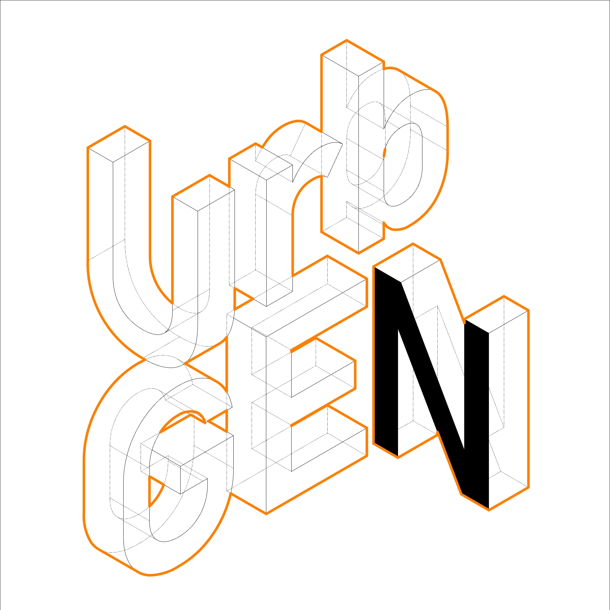
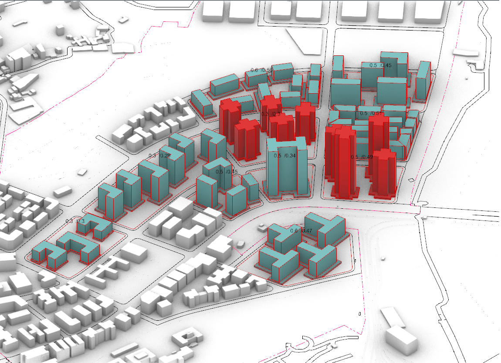
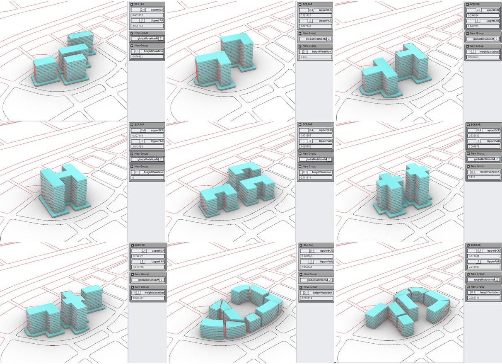
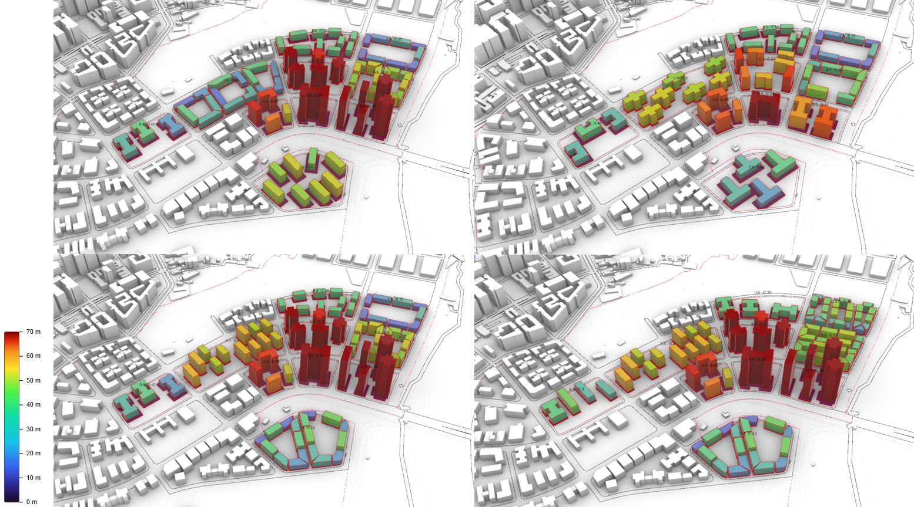

<p align="center">
  
</p>

<h1 align="center">UrbGEN</h1>

<p align="center">
  <strong>Generative urban massing under planning constraints</strong><br>
  A GhPython-based tool for Grasshopper / Rhino
</p>

<p align="center">
  <a href="https://rhinopackages.github.io/?owner=17087&search=urbgen&p=UrbGEN">
    </a>
  <a href="https://trongtintr.github.io/UrbGEN/">
    </a>
  
  
  
  <a href="LICENSE"></a>
</p>

---

UrbGEN is a GhPython-based generative urban massing tool for Grasshopper / Rhino
that automatically generates 3D building configurations from site boundaries and
planning constraints. It enables rapid exploration of seven building typologies
while targeting Building Coverage Ratio (BCR), Floor Area Ratio (FAR), building
height and orientation requirements, supporting early-stage urban design and
design-space exploration.

Instead of modelling massing options by hand, the designer defines the
regulatory envelope — coverage, plot ratio, height limit, setback — and UrbGEN
resolves a family of valid configurations that satisfy it.


<sub>Massing generated across eleven sites, coloured by building height.</sub>

---

## What's new in 0.1.15

- **No fallback geometry** — a site either returns a fully constrained layout or fails
  with a reason in `Errors`.
- **Nearest-edge alignment** — each building aligns to the boundary edge it is closest to;
  blocked towers are slid or shortened before a lower-priority orientation is tried.
  New output `TowerEdgeAngleError`.
- **Tighter BCR** — rewritten cascade solves the podium offset to 0.4 % of the target area;
  `upperBCR` is a hard ceiling.
- **~1.5–1.9× faster** generation.

Results differ from earlier versions at the same seed — see the
[CHANGELOG](CHANGELOG.md) before comparing with older datasets.

---

## Contents

- [What's new in 0.1.15](#whats-new-in-0115)
- [Installation](#installation)
- [Why BCR and FAR?](#why-bcr-and-far)
- [Key features](#key-features)
- [How it works](#how-it-works)
- [Building typologies](#building-typologies)
- [Planning parameters](#planning-parameters)
- [Components](#components)
- [Examples](#examples)
- [Research](#research)
- [Citation](#citation)
- [License](#license)
- [Authors and contact](#authors-and-contact)

---

## Installation

**Rhino Package Manager (recommended)**

Open Rhino 8, run the `PackageManager` command, search for **urbgen**, tick
**Include pre-releases** (UrbGEN is published as `-beta`) and install.
Restart Rhino — the components appear under the **UrbGEN** tab in Grasshopper.

UrbGEN requires **Rhino 8** (Python 3 / CPython script components).

**Yak CLI**

```
"C:\Program Files\Rhino 8\System\Yak.exe" install urbgen
```

**Manual**

Download the `.gha` file from [Releases](https://github.com/trongtintr/UrbGEN/releases)
and drop it into the Grasshopper components folder
(`%AppData%\Grasshopper\Libraries`). Right-click the file → **Properties** →
**Unblock**, then restart Rhino.

---

## Why BCR and FAR?

Building Coverage Ratio and Floor Area Ratio are how almost every zoning code
regulates urban form. But the pair **underdetermines form**: a parcel at
BCR 0.40 and FAR 3.0 can be slender towers on open ground, a perimeter block
around a courtyard, or a dense low mat. All equally compliant — and very
different for daylight, ventilation, thermal comfort and energy use.

That gap between compliance and performance is the research question. UrbGEN
treats the pair as a **constraint to converge on rather than an outcome to
measure afterwards**, generating hundreds of compliant alternatives at fixed
density — turning the regulatory envelope into a controlled experimental frame.

---

## Key features

<table>
<tr>
<td width="33%" valign="top">

**Constraint-driven**

Converges on target **BCR** and **FAR** simultaneously, reporting the achieved
values and the residual error for every site. Sites that cannot meet the
constraints are reported as failed — never patched with fallback geometry.

</td>
<td width="33%" valign="top">

**Seven typologies**

**I, L, T, H, C/U, Plus** and **Courtyard** footprints, selectable per site or
assigned automatically.

</td>
<td width="33%" valign="top">

**Multi-site batch**

Processes an entire block or district in one solve, with independent planning
targets per parcel.

</td>
</tr>
<tr>
<td width="33%" valign="top">

**Tower + podium**

Generates podium masses with configurable offset, floor count and thickness,
plus tower-to-podium ratio metrics.

</td>
<td width="33%" valign="top">

**Height regulation**

Enforces maximum and minimum building heights in strict or soft modes, and
reports violations and adjusted counts.

</td>
<td width="33%" valign="top">

**Design-space ready**

A seed input makes every run reproducible, so the component plugs directly into
Wallacei, Colibri or Sobol sampling.

</td>
</tr>
</table>

---

## How it works

The component takes a site curve and a set of planning targets, grows building
footprints, aligns them to the nearest boundary edges, calibrates coverage with
towers and podium until the BCR target is met, then derives floors from the FAR
target and extrudes the masses within the setback envelope.

[](images/urbgen-workflow.png)

<sub>Click to view the full definition.</sub>

**Pipeline**

1. **Input** — site boundary curve(s), setback distance, target BCR and FAR
2. **Populate** — candidate centroids distributed within the buildable area
3. **Typology** — footprint generated for each centroid from the selected grammar
4. **Grow** — footprints grown toward the tower share of the BCR target
5. **Align & position** — each tower aligned to its nearest boundary edge, then snapped
   to the boundary / setback
6. **BCR cascade** — towers rescaled and the podium offset solved until the BCR target is
   met (never above `upperBCR`)
7. **Extrude** — floor counts derived from the FAR target, floor height and height limits
8. **Report** — actual BCR / FAR / GFA / heights, edge-alignment error and the reason for
   any failed site

---

## Building typologies

Seven footprint grammars — **I, L, T, H, C/U, Plus, Courtyard** (plus a *mixed*
mode) — each parametrised by arm length ratio, width, and length-to-width limits.




<sub>Nine configurations at BCR 0.40 / FAR 3.0 — the constraint is held constant
while the typology and rotation mode vary.</sub>


<sub>C/U typology under the same planning envelope, with and without global rotation.</sub>

---

## Planning parameters

| Parameter | Input | Description |
|---|---|---|
| **FAR** | `FAR` | Target floor area ratio; drives floor count and total GFA |
| **BCR** | `BCR`, `upperBCR` | Target building coverage ratio and its hard ceiling |
| **Height** | `maxBuildingHeight`, `minBuildingHeight`, `heightVariation` | Regulated envelope with strict or soft enforcement |
| **Setback** | `setback` | Offset from the site boundary defining the buildable area |
| **Orientation** | `globalRotationMode`, `uniformRotationDeg`, `alignTowersToEdge` | Uniform, per-building or edge-aligned rotation |

Additional groups cover **sizing and density** (footprint bounds, minimum tower
distance, growth step and iterations), **podium** (floors, offset range, floor
height), **courtyard** (count, break width, split angle, layout mode) and
**positioning** (snap to boundary, snap to setback, edge alignment).

See the [component reference](https://trongtintr.github.io/UrbGEN/components/UrbGENgenerator/)
for the full list of inputs and outputs.



<sub>Four generated alternatives on the same site, coloured 0–70 m.</sub>

---

## Components

| | Component | Purpose |
|---|---|---|
|  | [**UrbGEN Populate Region**](https://trongtintr.github.io/UrbGEN/components/UrbGENPopulateRegion/) | *1 · Site* — populate a closed region with seed points, by count or by minimum distance |
|  | [**UrbGEN Massing Generator**](https://trongtintr.github.io/UrbGEN/components/UrbGENgenerator/) | *2 · Massing* — podium + tower massing for one or many sites under FAR / BCR / setback / height limits |
|  | [**UrbGEN Height Colors**](https://trongtintr.github.io/UrbGEN/components/UrbGENHeightColors/) | *3 · Visualise* — colour buildings by height, with a height legend |
|  | [**UrbGEN Palette**](https://trongtintr.github.io/UrbGEN/components/UrbGENPalette/) | *3 · Visualise* — 70 sequential and diverging palettes for height colouring and heatmaps |
|  | [**UrbGEN Scheme Tag Viewer**](https://trongtintr.github.io/UrbGEN/components/UrbGENSchemeTagViewer/) | *3 · Visualise* — show each scheme's `SchemeTag` (target vs actual FAR / BCR) next to its site |

---

## Examples

A typical definition: site curves on the left, planning targets grouped by
category in the middle, the UrbGEN component and its outputs on the right.


<sub>Each site is labelled with its target BCR and the value actually achieved.</sub>

Because the solver is seeded, the same definition can be swept across a
parameter space to produce large sets of valid alternatives:


<sub>64 of 1000 designs — Site 3, 18,481 m², at FAR 3.0 and BCR 40%.</sub>


Sample Grasshopper definitions covering single-site, multi-site and design-space
workflows are in
[`UrbGEN_example_v0.1.11beta/`](https://github.com/trongtintr/UrbGEN/tree/main/UrbGEN_example_v0.1.11beta).

---

## Research

UrbGEN was developed as part of ongoing research on generative urban morphology
and environmental performance. The tool couples a rule-based footprint grammar
with an iterative growth solver.

Generated datasets feed downstream analysis in Ladybug / Honeybee, ENVI-met and
multi-objective optimisation workflows, supporting studies of daylight, view
access, energy use intensity and outdoor thermal comfort across morphological
alternatives.

---

## Citation

If you use UrbGEN in academic work, please cite it as:

```bibtex
@software{tran_urbgen,
  author  = {Tran, Trong-Tin and Chan, Ying-Chieh},
  title   = {UrbGEN: Generative urban massing under planning constraints},
  url     = {https://github.com/trongtintr/UrbGEN},
  note    = {Ying-Chieh Chan's Lab, Department of Civil Engineering,
             National Taiwan University}
}
```

---

## Changelog

See [CHANGELOG.md](CHANGELOG.md) for release notes.

---

## License

Released under the [MIT License](LICENSE).

---

## Authors and contact

**[Trong-Tin Tran](https://sites.google.com/view/trantrongtin)** and
**[Ying-Chieh Chan](https://yingchiehchan.com/)**

Ying-Chieh Chan's Lab, Department of Civil Engineering,
National Taiwan University

[trongtintr@outlook.com](mailto:trongtintr@outlook.com) ·
[D14521024@ntu.edu.tw](mailto:d14521024@ntu.edu.tw)

Bug reports and feature requests are welcome via
[Issues](https://github.com/trongtintr/UrbGEN/issues).